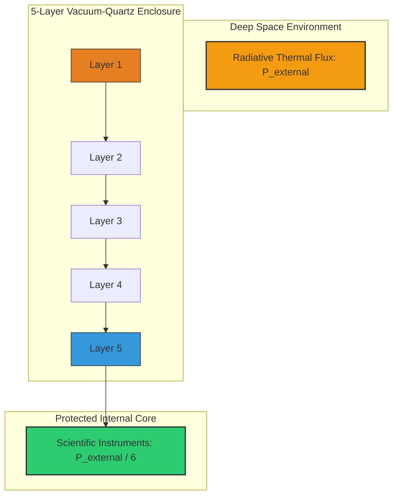

# 🌌 Unbending Sand: Multi-Layer Radiative Attenuation Enclosure

This project introduces a 100% passive, structural thermal protection system designed for deep-space probes operating in close proximity to stars or extreme high-temperature stellar environments. Bypassing active cooling infrastructure, the architecture utilizes a multi-layered fused silica (quartz glass) array separated by absolute vacuum voids to systematically decay radiative heat flux before it reaches the internal core instrumentation.

---

## 🛠️ 1. Thermodynamic & Mechanical Architecture

The protective shielding eliminates thermal conduction and convection, relying strictly on structural geometry and radiative decay to shield deep-space instruments:

- **Five-Layer Fused Silica Matrix (N=5):** The outermost protective enclosure consists of five concentric, high-purity quartz glass shells. Fused silica is selected for its high melting point, mechanical rigidity, and absolute resilience to sudden thermal shock.
- **Absolute Vacuum Voids (0 Torr Isolation):** Each of the five quartz layers is structurally isolated from the next by a complete vacuum gap. By removing all gas molecules between the frames, thermal conduction and convective heat transfer are physically reduced to zero. 
- **Passive Radiative Attenuation Vector:** Because conduction and convection are blocked, energy can only transfer via radiation. Each subsequent internal layer absorbs and re-radiates the thermal flux, creating a progressive attenuation cascade that drastically weakens the internal energy transfer relative to the layer count:

$$P_{\text{internal}} \approx \frac{P_{\text{external}}}{N + 1} = \frac{P_{\text{external}}}{6}$$

---

## 🔄 2. Passive Operations & Mission Profiles

Operating without mechanical coolant pumps, active radiators, or electrical power draw, the probe maintains internal thermal equilibrium purely through structural geometry. The outermost layers safely absorb the direct high-intensity stellar thermal payload, distributed evenly across the matrix, while the innermost layer preserves a stable low-energy baseline suitable for delicate deep-space scientific instrumentation.

---

## 📐 3. Engineering Framework & Development Vectors

The structural layout and boundary constraints are locked in. Contributors and engineering minds are welcome to review the core logic and expand the system within the following vectors:
- **Radiative Transfer Modeling (`calculations.py`):** Populating the thermodynamic code arrays with high-accuracy radiation physics equations.
- **Non-Conductive Structural Standoffs:** Engineering micro-supports to maintain the vacuum gaps between the quartz shells without establishing parasitic thermal bridges.
- **UV and Solar Wind Degradation Curves:** Evaluating the long-term structural integrity of fused silica coatings under continuous high-energy particle bombardment.

---

## 📄 License

This project is licensed under the **MIT License** – preserving the original architecture credited to the creator.

Copyright (c) 2026 masakertsa
