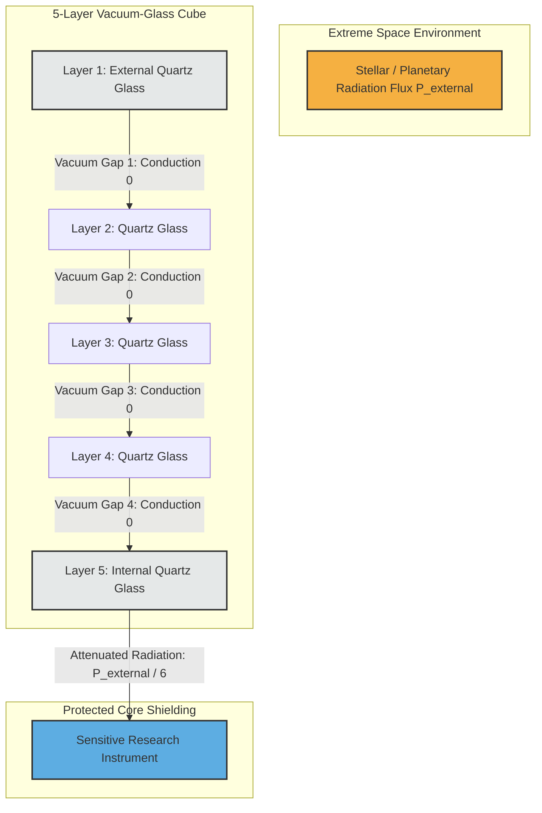

# 🌌 Unbending Sand: Multi-Layer Radiative Attenuation Enclosure

This project introduces a high-logic, passive thermal protection system designed for deep-space research probes operating in extreme proximity to hot planets or stars. Operating entirely without active cooling or power consumption, the architecture leverages five independent layers of high-purity quartz glass—engineered from fused silica sand—separated by complete vacuum gaps to eliminate conductive and convective heat transfer, leaving thermal radiation as the only remaining vector.

## 🛠️ Thermodynamic Architecture & Physics Framework

The core scientific vehicle or research instrument is encapsulated in a rigid, cubic enclosure optimized to minimize surface area exposure while maximizing multi-directional deflection:

- **1. Five-Layer Quartz Matrix (N=5):** The outermost protective envelope consists of five individual shells of high-purity quartz glass, derived from refined sand. Quartz is selected for its high melting point, structural rigidity under thermal stress, and specific electromagnetic transmission properties.
- **2. Inter-Layer Vacuum Isolation:** The gaps between the five quartz walls are engineered as hard vacuums (0 Torr). Because space vacuum contains no gas molecules, conductive heat transfer and convective currents are mathematically reduced to zero ($Q_{conv} = 0$, $Q_{cond} = 0$). Thermal energy can only move through the shield via radiative emission.
- **3. Cascading Radiation Attenuation:** According to thermal radiation shield physics, each isolated layer acts as a local heat absorber and re-radiator. In an ideal system, the total radiative flux ($P$) reaching the inner core drops significantly with each layer:
  $$P_{internal} \approx \frac{P_{external}}{N + 1} = \frac{P_{external}}{6}$$
  This cascading drop ensures that even when the outermost layer glows from intense planetary or stellar heat, the inner research apparatus remains well within its safe operational limits.

## 🔄 Passive Deep Space Operation & Lifecycle

- **Deployment Phase:** The probe enters a low-altitude orbit around a high-radiation, hot planetary body (e.g., a Vulcanoid or close-in Gas Giant). The shield faces the extreme radiation flux directly.
- **Radiative Equilibrium:** The outer glass sheet absorbs the brutal thermal load and reaches a high temperature, radiating half its energy back into deep space and half to the second layer. This heat-splitting effect repeats through all five layers.
- **Hands-Free Instrument Protection:** The core instrument inside executes its sensor sweeps and data transmission completely passively, shielded from extreme thermal spikes without heavy, breakable mechanical refrigeration pumps.

## 🗺️ Framework Implementation & Open Invitations

This repository serves as a foundational conceptual framework for extreme-environment deep-space exploration. Contributions and validation are welcome from global experts in astrophysics, thermodynamics, and optical materials:

- **Radiative Transfer Modeling:** Refining `calculations.py` with precise Stefan-Boltzmann gray-body radiation equations accounting for real-world quartz emissivity.
- **Structural Material Science:** Simulating ultra-thin, low-conductivity mechanical spacers to hold the five glass layers apart without creating conductive heat bridges.
- **Stellar Spectrum Analysis:** Modeling how the quartz layers degrade over extended exposures to intense solar UV and high-energy solar winds.

## 📄 License

This project is licensed under the **MIT License** – preserving the original architecture credited to the creator.

Copyright (c) 2026 masakertsa
