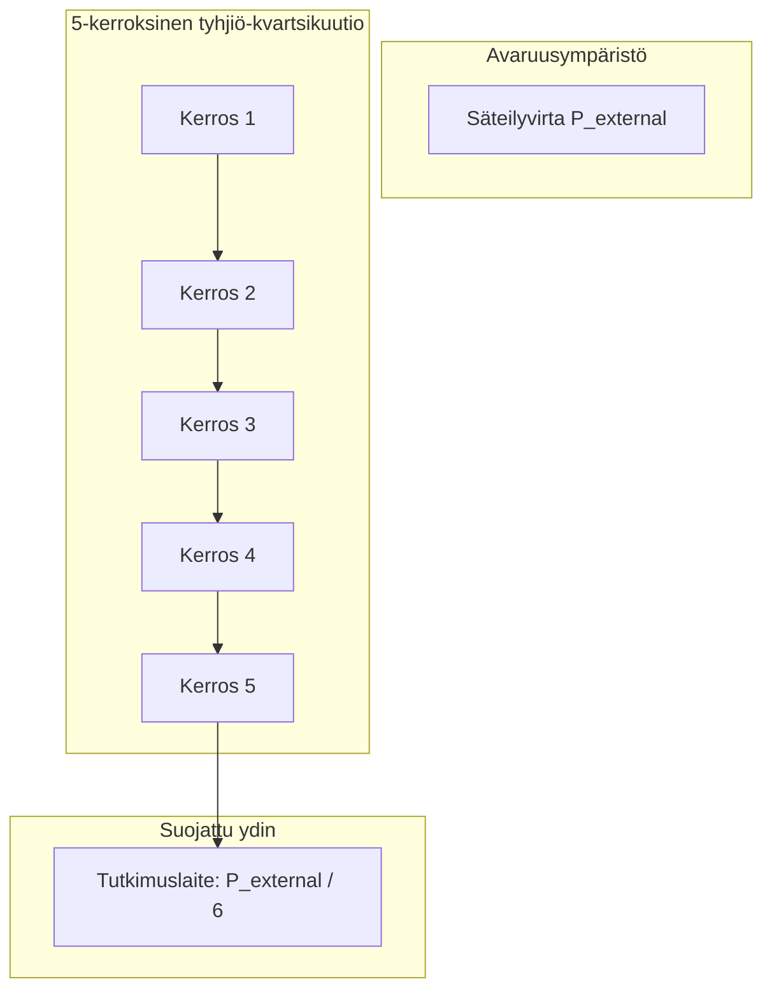

# 🌌 Unbending Sand: Multi-Layer Radiative Attenuation Enclosure

Tämä projekti esittelee passiivisen lämpösuojausjärjestelmän syvän avaruuden luotaimille, jotka toimivat kuumien planeettojen tai tähtien läheisyydessä. Rakenne hyödyntää viittä korkeapuhtaasta kvartsilasista valmistettua kerrosta, jotka on erotettu tyhjiöväleillä johtumisen ja konvektion eliminoimiseksi.

## 🛠️ Termodynaaminen arkkitehtuuri

- **Viisikerroksinen kvartsimatriisi (N=5):** Ulkokuori koostuu viidestä kvartsilasikerroksesta, jotka kestävät korkeita lämpötiloja ja lämpörasitusta.
- **Tyhjiöeristys:** Kerrosten välissä on tyhjiö (0 Torr), jolloin lämpö voi siirtyä vain säteilemällä.
- **Säteilyn vaimeneminen:** Lämpösäteilyvirta pienenee kerros kerrokselta:
  $$P_{internal} \approx \frac{P_{external}}{N + 1} = \frac{P_{external}}{6}$$

## 🔄 Passiivinen toiminta

Luotain kykenee operoimaan ilman mekaanisia jäähdytyspumppuja, kun ulompi kvartsikerros jakaa ja säteilee lämpökuormaa eteenpäin kerroksittain kohti sisäosaa.

## 🗺️ Kehitys ja osallistuminen

Avoimeen viitekehykseen otetaan vastaan parannusehdotuksia liittyen:
- Säteilynsiirron mallinnukseen (`calculations.py`)
- Rakenteellisiin väliseiniin ilman lämpösiltoja
- Kvartsikerrosten kestävyyteen UV-säteilyllä

## 📄 Lisenssi

Tämä projekti on lisensoitu **MIT-lisenssillä**.

Copyright (c) 2026 masakertsa
